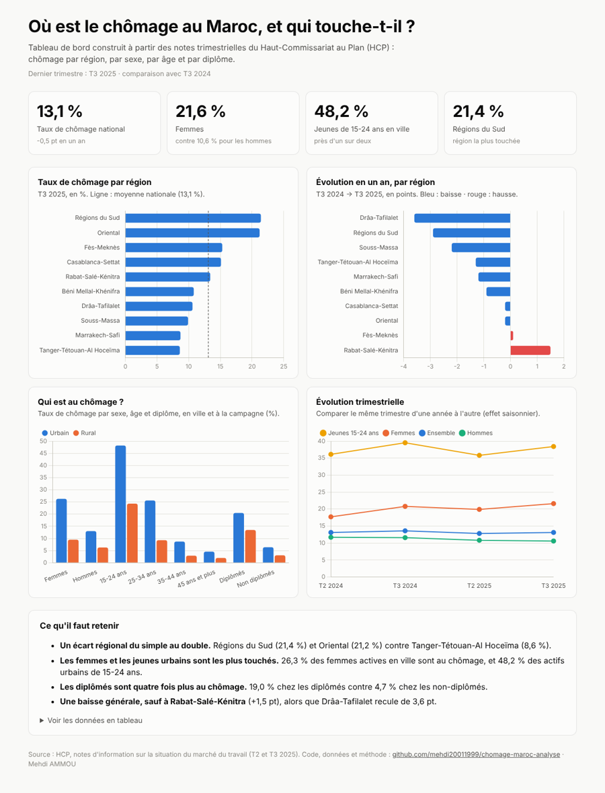
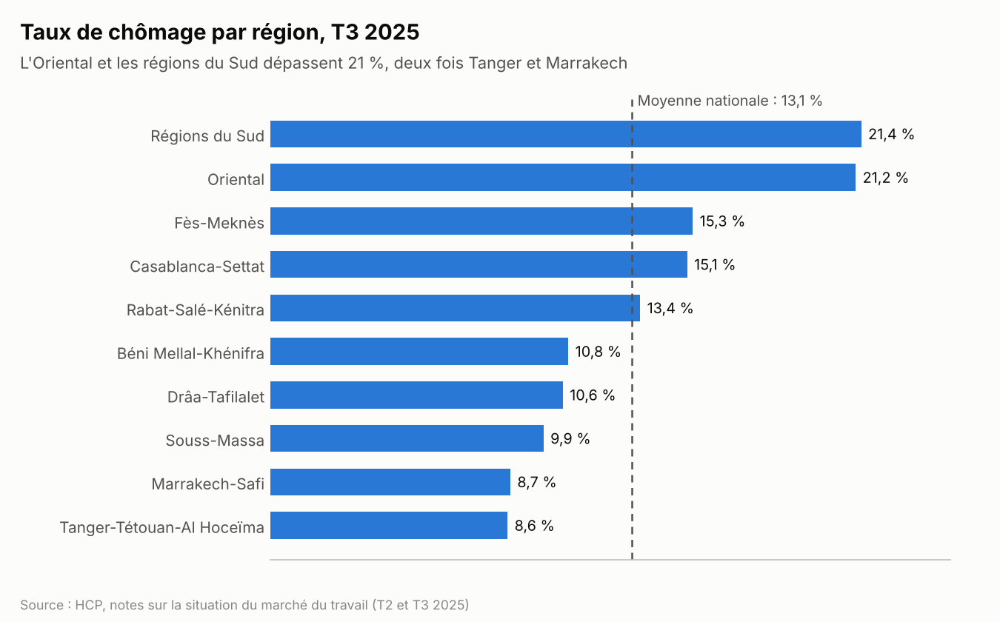
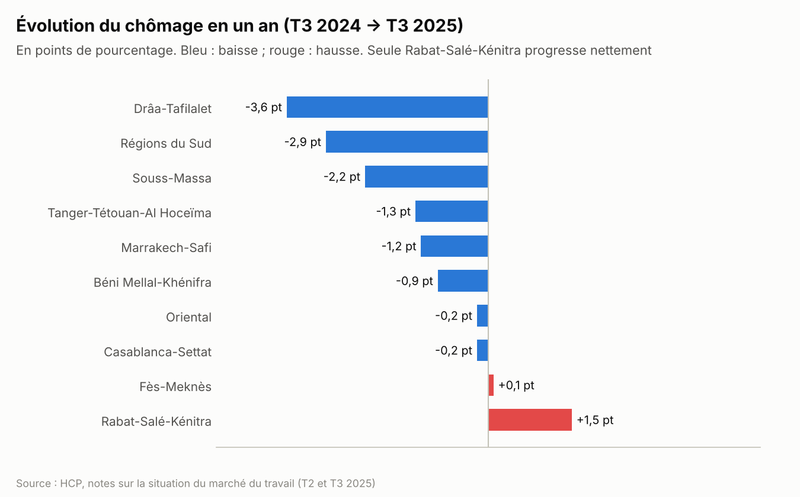
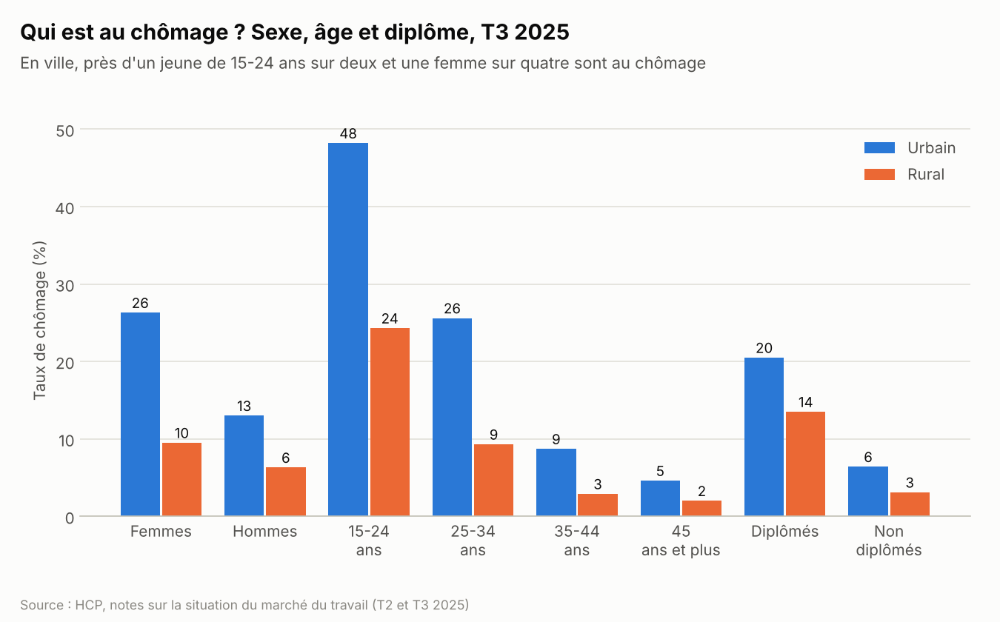
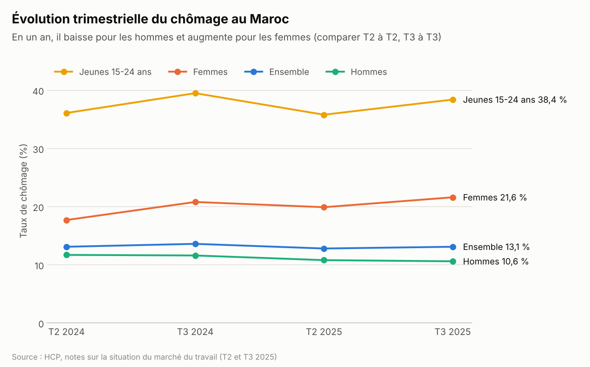

# Chômage au Maroc : où, et qui ?

[](https://github.com/mehdi20011999/chomage-maroc-analyse/actions/workflows/ci.yml)

Analyse du chômage au Maroc **par région, sexe, âge et diplôme**, à partir des notes trimestrielles officielles du **Haut-Commissariat au Plan (HCP)**.
Les données sont extraites des documents du HCP, contrôlées, chargées dans une base SQL, puis présentées dans des graphiques, un rapport Excel et un tableau de bord web.

**Tableau de bord : https://mehdi20011999.github.io/chomage-maroc-analyse/**



## La question

> Où le chômage est-il le plus élevé au Maroc, et quelles populations touche-t-il le plus ?

Période couverte : T2 2024, T3 2024, T2 2025 et T3 2025, avec 10 régions et la moyenne nationale.

## Ce qu'il faut retenir (T3 2025)

1. **Un écart régional du simple au double.** Les Régions du Sud (21,4 %) et l'Oriental (21,2 %) ont un taux de chômage 2,5 fois plus élevé que Tanger-Tétouan-Al Hoceïma (8,6 %) et Marrakech-Safi (8,7 %).
2. **Les jeunes urbains et les femmes sont les plus touchés.** En ville, 48,2 % des actifs de 15-24 ans et 26,3 % des femmes actives sont au chômage. Au niveau national, le taux des femmes (21,6 %) est le double de celui des hommes (10,6 %).
3. **Les diplômés sont quatre fois plus au chômage** que les non-diplômés : 19,0 % contre 4,7 %.
4. **Une baisse générale sur un an, avec une exception.** Le taux national passe de 13,6 % à 13,1 %. Drâa-Tafilalet recule de 3,6 points, mais Rabat-Salé-Kénitra progresse de 1,5 point.
5. **Le chômage baisse pour les hommes mais augmente pour les femmes** : de 20,8 % à 21,6 % entre T3 2024 et T3 2025.
6. **Le sous-emploi progresse** : de 10,0 % à 11,1 % des actifs occupés, et jusqu'à 13,8 % à la campagne.

| | |
|---|---|
|  |  |
|  |  |

## Méthode

```
Notes du HCP (.docx)  ──►  extract.py  ──►  CSV « long »  ──►  tests  ──►  SQLite + SQL  ──►  graphiques, Excel, tableau de bord
   data/raw/                (pandas)      data/processed/    (pytest)     sql/analyses.sql      figures/, results/, docs/
```

1. **Extraction** (`src/extract.py`). Lecture des trois tableaux de chaque note : activité et emploi, chômage, régions. Les données sont mises au format « long » (une ligne = une valeur) et les libellés sont harmonisés, car ils changent légèrement d'une note à l'autre (« Taux de féminité » ou « de féminisation », « Industrie » ou « Industrie y compris l'artisanat »…).
2. **Contrôles de qualité** (`tests/test_donnees.py`, 19 tests).
   - Couverture : 4 trimestres et 10 régions pour chaque indicateur, sans doublon.
   - Plausibilité : tous les taux sont compris entre 0 et 100.
   - Exactitude : des valeurs témoins ont été relues à la main dans les notes du HCP.
   - **Cohérence interne** : la relation *taux d'emploi = taux d'activité × (1 − taux de chômage)* est vérifiée pour chaque région et chaque trimestre. Les secteurs d'activité totalisent 100 %, et la population active est bien la somme des actifs occupés et des chômeurs. Si une ligne ou une colonne avait été décalée à l'extraction, ces tests échoueraient.
3. **Analyse SQL** (`sql/analyses.sql`). Les requêtes produisent :
   - le classement des régions, avec fonction de fenêtre `RANK()` et écart à la moyenne nationale ;
   - l'évolution sur un an, par auto-jointure ;
   - les taux par groupe, avec un pivot urbain/rural en `CASE WHEN` ;
   - la tendance nationale et le sous-emploi.
4. **Restitution** (`src/analyze.py`). Le script produit :
   - 4 graphiques avec une palette lisible par les daltoniens ;
   - le rapport Excel `results/rapport_chomage_maroc.xlsx`, avec une feuille par analyse et les données brutes ;
   - les données du tableau de bord (`docs/data.json`).

**Point de méthode.** Le marché du travail est saisonnier, donc les évolutions comparent toujours **le même trimestre d'une année à l'autre** (T3 2025 contre T3 2024), jamais deux trimestres qui se suivent.

## Lancer le projet

```bash
python -m venv .venv && source .venv/bin/activate   # Windows : .venv\Scripts\activate
pip install -r requirements.txt
python src/extract.py     # docx -> data/processed/*.csv
pytest                    # contrôles de qualité
python src/analyze.py     # SQL, graphiques, Excel, tableau de bord
```

Pour voir le tableau de bord en local, lancez `python -m http.server -d docs`, puis ouvrez http://localhost:8000.

Pour **ajouter un trimestre**, déposez la nouvelle note du HCP au format .docx dans `data/raw/`, puis relancez les trois commandes.

## Intégration continue

À chaque modification, GitHub Actions :
1. refait l'extraction ;
2. lance les contrôles de qualité ;
3. rejoue l'analyse ;
4. vérifie que les fichiers publiés (CSV, `data.json`) correspondent exactement au code.

Le rapport Excel et les graphiques sont disponibles en téléchargement dans l'onglet *Actions*.

## Structure

```
data/raw/            notes du HCP (source)
data/processed/      national.csv, regions.csv (données propres)
sql/                 schema.sql, analyses.sql
src/                 extract.py, analyze.py
tests/               contrôles de qualité des données
results/             résultats des requêtes (CSV) + rapport Excel
figures/             graphiques
docs/                tableau de bord (GitHub Pages)
```

## Source

Haut-Commissariat au Plan, *Note d'information sur la situation du marché du travail*, deuxième et troisième trimestres 2025 (www.hcp.ma). Les chiffres sont reproduits tels que publiés, et les éventuelles erreurs d'interprétation sont les miennes.

---
Mehdi AMMOU · [Portfolio](https://portfolio-mehdi-main.vercel.app) · [LinkedIn](https://linkedin.com/in/ammou-mehdi-483b6226b)
